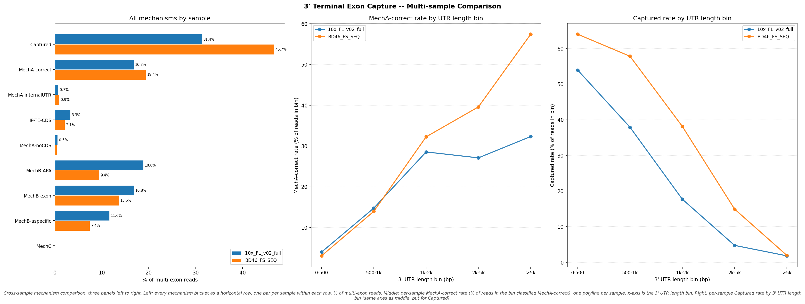
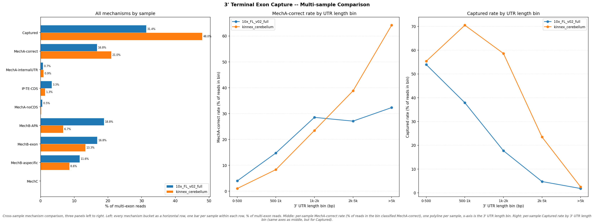

# tecap

[](https://github.com/FullLengthFanatic/tecap/actions/workflows/test.yml)
[](https://doi.org/10.5281/zenodo.19762736)

3' terminal exon capture diagnostics for long-read single-cell RNA-seq.

`tecap` classifies long-read alignments by where their 3' end lands relative to the terminal exon (TE), its UTR, and a polyA site atlas. It decomposes capture failures into nine mechanism buckets (successful capture, truncation at a real polyA site, a UTR site away from any polyA site, a CDS site, alternative polyadenylation, an upstream-exon site, an intronic or flanking site, downstream readthrough) and measures reference base composition downstream of each read's site: it labels the site templated, non-templated or ambiguous from the adenines in the 20 nt downstream, and reports two descriptive bands of the adenine share (30% to 50% A, 60% A or more). The bucket says where the site is, the label says what kind of site it is. Empirically the two bands split single-cell preps from bulk Iso-Seq; the biochemical driver of the split is currently uncharacterized.

Designed for PacBio Iso-Seq / Kinnex and Oxford Nanopore cDNA BAMs. Direct-RNA sequencing is explicitly unsupported (no RT, no priming artifact to diagnose).

## Mechanisms

Every classified read lands in exactly one of nine buckets, defined by where
its 3' end falls relative to the terminal exon (TE), the TE's UTR / CDS, and
the nearest annotated PolyASite cluster.

| Bucket | What it means | Why it matters |
|---|---|---|
| **Captured** | Read 3' end lands in the terminal exon and the read covers >=50% of it. | Successful full-length capture of the mRNA 3' end; the goal of any 3'-end protocol. |
| **MechA-correct** | Read 3' end is in the TE 3' UTR within +-25 bp of an annotated PolyASite cluster, but the read covers <50% of the TE. | Truncated transcript that nonetheless terminates at a real polyA site; common with degraded input or short-fragment library prep. |
| **MechA-internalUTR** | Read 3' end is in the TE 3' UTR but not within +-25 bp of any annotated polyA cluster. | Candidate internal priming site in the UTR; no annotated polyA cluster supports it. |
| **IP-TE-CDS** | Read 3' end is inside the terminal exon's CDS portion (i.e. before the UTR begins). | Candidate internal priming site; real polyA sites are rare in coding sequence. |
| **MechA-noCDS** | Read 3' end is inside the TE of a non-coding gene (no CDS to delimit a UTR). | Coding/UTR split does not apply; reported separately so the coding-gene buckets stay clean. |
| **MechB-APA** | Read 3' end is upstream of the terminal exon but at an annotated polyA cluster on an upstream exon. | Alternative polyadenylation isoform, supported by an annotated polyA cluster. |
| **MechB-exon** | Read 3' end is on an upstream exon, with no annotated polyA cluster nearby. | Candidate internal priming site on an upstream exon; no annotated polyA cluster supports it. |
| **MechB-aspecific** | Read 3' end is upstream of the TE in an intron or gene flank. | Pre-mRNA priming or off-target alignment. |
| **MechC** | Read 3' end is downstream of the terminal exon end. | Read-through, unannotated 3' UTR extension, or alignment artifact past the annotated TE. |

The basecomp subcommand also splits Captured / MechA / MechB-APA reads by
whether their cluster carries a canonical AAUAAA-like hexamer (PAS+/-).

Run `tecap explain` to print these definitions on the terminal, or
`tecap explain --mechanism MechA-correct --format json` for a single entry.

## Reading the plots

- `{sample}_terminal_exon.png` — three panels: bucket fractions, read-length
  density (Captured vs MechA-correct), and rates by 3' UTR length bin.
  Capture failures concentrate in the long-UTR bins.
- `{sample}_mecha_scatter.png` — read length vs TE coverage for
  MechA-correct reads only; reads above the dashed coverage threshold get
  promoted to Captured.
- `{sample}_basecomp.png` — eight panels, one per bucket, showing %A in
  the reference window downstream of each read's site. **Grey band:** 30%
  to 50% A. **Dashed line:** 60% A. Both are descriptive bands, not
  priming mechanisms: the bucket says where the site is, the label
  (templated, non-templated, ambiguous) says what kind of site it is.
  Empirically, single-cell prep datasets (10x, in-house FLASH-seq
  variants on the BD Rhapsody platform and on plates, ArgenTag)
  cluster in the grey band; bulk Iso-Seq datasets
  cluster past the dashed line. The biochemical driver of this split
  is currently uncharacterized.
- `comparison_*.png` — same panels, multiple samples grouped on the same
  axes. Generated by `tecap compare` or `tecap report` (multi-sample mode).

## Install

```bash
pip install git+https://github.com/FullLengthFanatic/tecap@v0.5.0
```

Development install:

```bash
git clone https://github.com/FullLengthFanatic/tecap
cd tecap
pip install -e .[dev]
pytest
```

## Quick start

```bash
# Classify reads. References are auto-fetched on first run and cached
# under ~/.cache/tecap/GRCh38/.
tecap classify \
    --bam sample.bam \
    --genome GRCh38 \
    --gtf-version 45 \
    --sample S1 \
    --out-dir results/ \
    --threads 8 \
    --platform cdna-pacbio \
    --verbose

# Or pass references explicitly (no auto-download):
tecap classify \
    --bam sample.bam \
    --gtf gencode.v45.annotation.gtf.gz \
    --polya-sites atlas.clusters.3.0.GRCh38.GENCODE_42.bed.gz \
    --sample S1 --out-dir results/ --threads 8

# Measure base composition in the 20 nt window downstream of each read's site
tecap basecomp \
    --bam sample.bam \
    --genome GRCh38 \
    --gtf-version 45 \
    --fasta GRCh38.primary_assembly.genome.fa.gz \
    --sample S1 \
    --out-dir results/ \
    --threads 8 \
    --verbose

# Render a self-contained HTML report (per-sample)
tecap report \
    --classify-json results/S1_terminal_exon.json \
    --basecomp-json results/S1_basecomp.json \
    --out-html results/S1_report.html

# Cross-sample HTML report (space-separated paths)
tecap report \
    --classify-json results/A_terminal_exon.json results/B_terminal_exon.json \
    --basecomp-json results/A_basecomp.json results/B_basecomp.json \
    --out-html results/compare.html

# Print the mechanism glossary
tecap explain
tecap explain --mechanism MechA-correct --format json

# Cross-sample comparison plots only (no HTML)
tecap compare \
    --mode classify \
    --inputs results/A_terminal_exon.json,results/B_terminal_exon.json \
    --out-dir results/

# Fetch references explicitly (otherwise --genome handles this)
tecap download-atlas \
    --genome GRCh38 \
    --gtf-version 45 \
    --out-dir ref/
```

## Outputs

Per sample (classify):
- `{sample}_terminal_exon.json` — bucket counts, fractions, PAS split, UTR-length stratification, orientation sanity check, read-length medians.
- `{sample}_terminal_exon.png` — 3-panel summary plot.
- `{sample}_mecha_scatter.png` — read length vs TE coverage for MechA-correct reads.
- `{sample}_tecap_mqc.json` — MultiQC custom-content table (auto-detected by the `_mqc.json` suffix).
- `{sample}_per_gene.tsv` (optional, with `--per-gene-table`) — per-gene bucket counts.

Per sample (basecomp):
- `{sample}_basecomp.json` — %A histograms per bucket, medians, >=60% and 30-50% fractions.
- `{sample}_basecomp.png` — 8-panel histogram grid.

`frac_ge_60`, `frac_30_50` and `frac_ge_40` are descriptive bands of the adenine share in the window (60% or more, 30% to under 50%, 40% or more). They do not name a priming mechanism. The label is in `frac_templated`, `frac_nontemplated` and `frac_ambiguous`.

Both JSONs say how strandedness was handled. `--strandedness` takes `auto` (the default), `stranded` or `unstranded`; `auto` looks at the first 200,000 reads the run would classify, in BAM order, and calls the input stranded when 0.80 or more of them lie on the strand of their best-overlap gene. `strandedness` records `requested`, `resolved` and `probe` (the probe's `reads`, `match_frac` and `stranded`, null unless `auto`). A read's gene is the gene whose span overlaps it the most, genes on both strands competing. On stranded input a read antisense to that gene is classified against the best-overlap gene on its own strand instead and counted in `antisense_reassigned`. A read with no gene on its strand is skipped: it gets no bucket, site or window and is counted in `antisense_skipped` only. `orient_match_frac` is computed before the reassignment and the skip and counts both kinds of read as mismatches; `total`, the category counts and the bucket `n` include the reassigned reads and leave the skipped ones out. The HTML report, the MultiQC table and the console summary show none of `strandedness`, `antisense_reassigned` and `antisense_skipped`. On input that `auto` calls unstranded every read keeps its best-overlap gene on either strand and nothing is reassigned or skipped, and tecap still warns when the run's BAM/gene-strand match fraction is below 0.80.

Cross-sample:
- `comparison_terminal_exon.png` — grouped bars across samples.
- `comparison_basecomp.png` — per-bucket histogram overlays.

### Example plots

#### Datasets used in the example plots

Five of the six samples are PacBio HiFi sequenced after Kinnex
concatenation: most use the Kinnex Full-length kit (8x), while the
public ArgenTag sample uses the Kinnex Single Cell kit (12x).
`PBMC_FS_ONT` is the exception, sequenced as Oxford Nanopore cDNA
without Kinnex.

| Sample | Tissue | Organism | Source |
|---|---|---|---|
| `10x_FL_v02_full` | Retinal organoid | Human | In-house. 10x GEM-X 3' RNA-seq kit, then Kinnex FL (8x), PacBio HiFi. |
| `BD46_FS_SEQ` | Retinal organoid | Human | In-house. FLASH-seq variant on the BD Rhapsody platform (bead-bound oligo-dT capture), then Kinnex FL (8x), PacBio HiFi. |
| `PBMC_FS_ONT` | PBMC | Human | In-house. Plate-based FLASH-seq, sequenced as ONT cDNA (no Kinnex). |
| `MDA_argentag_kinnex12x` | MDA-MB-453 cell line | Human | Public ArgenTag, nanowell single-cell + Kinnex SC (12x), PacBio HiFi. Source: [downloads.pacbcloud.com/public/dataset/Kinnex-single-cell-RNA/DATA-RevioSPRQ-Kinnex-ArgenTag-MDAcellLine/MDA-12fold/](https://downloads.pacbcloud.com/public/dataset/Kinnex-single-cell-RNA/DATA-RevioSPRQ-Kinnex-ArgenTag-MDAcellLine/MDA-12fold/). |
| `kinnex_cerebellum` | Cerebellum (bulk) | Human | Public PacBio bulk Iso-Seq + Kinnex FL (8x). Source: [downloads.pacbcloud.com/public/dataset/Kinnex-full-length-RNA/](https://downloads.pacbcloud.com/public/dataset/Kinnex-full-length-RNA/). |
| `kinnex_heart` | Heart (bulk) | Human | Public PacBio bulk Iso-Seq + Kinnex FL (8x). Source: [downloads.pacbcloud.com/public/dataset/Kinnex-full-length-RNA/](https://downloads.pacbcloud.com/public/dataset/Kinnex-full-length-RNA/) (same parent bucket as cerebellum). |

In-house datasets are not deposited in SRA / GEO; the chemistry
descriptions above are sufficient to identify what was run. Public
datasets have no associated DOI / paper at this time; URLs link to
the PacBio public download locations.

Two pairwise comparisons rendered with `tecap report`. All samples
human GRCh38, sequenced as FL Kinnex / MAS-ISO / PacBio HiFi.

**Single-cell vs single-cell:** 10x Kinnex (`10x_FL_v02_full`) vs
`BD46_FS_SEQ`, an in-house FLASH-seq variant on the BD Rhapsody
platform with Kinnex concatenation (not stock Rhapsody chemistry).




**Single-cell vs bulk Iso-Seq:** 10x Kinnex vs PacBio Kinnex bulk
cerebellum.




HTML report (`tecap report`):
- Self-contained `.html` per sample (and per comparison) with embedded
  PNGs, executive summary tiles, mechanism legend, per-bucket tables,
  PAS split, and UTR-length stratification. Single file, no JS.

## Citation

If you use `tecap`, please cite the GitHub release DOI (see `CITATION.cff`).

## License

MIT
